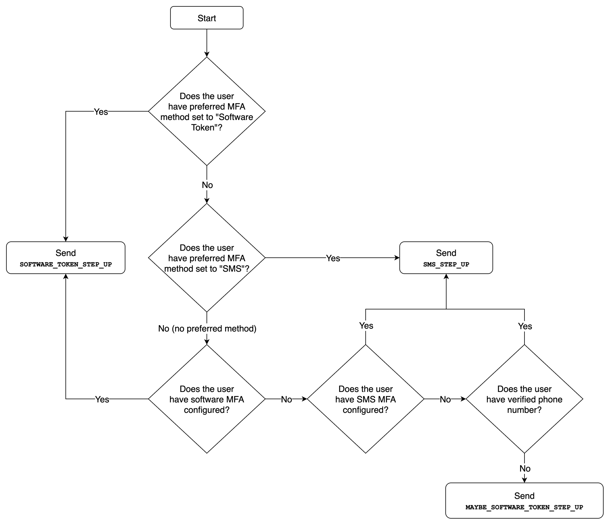
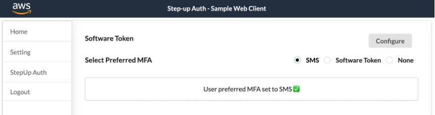

## How to implement Step-up Authentication using Amazon Cognito

> **Security update (November 2026)**
>
> This sample was updated to fix a step-up session expiry defect and other security issues. If you deployed an earlier version, remove it with that version's `deployment/undeploy.sh`, then deploy the latest `main` as a new installation.
>
> - **Session expiry is now enforced in code.** Earlier versions relied on DynamoDB TTL to end a step-up session, and the authorizer didn't check `ttl`. Because DynamoDB can take days to delete expired items, a completed step-up stayed valid until the access token expired (up to 60 minutes by default), whatever `SESSION_TABLE_ITEM_TTL` was set to. The authorizer now rejects a session once its `ttl` has passed, and `ttl` is never later than the access token's expiry.
> - **Other fixes:** the respond-to-challenge function now waits for the access token signature check and for the session update to be saved. Debug logs redact AWS credentials and tokens. The Lambda role can access only this solution's DynamoDB tables. The authorizer denies requests it can't evaluate, and an API's `STEP_UP_DENY` setting now applies even when the caller has completed step-up.
> - **Platform:** the Lambda functions run on Node.js 24, the deployment uses AWS CDK v2, and the web app uses Amplify JS v6.
> - **If you deployed an earlier version with `NODE_ENV=development`,** its Lambda log groups may contain the functions' temporary AWS credentials and users' tokens. Restrict access to those log groups or delete them.
> - **Blog posts:** [Part 1](https://aws.amazon.com/blogs/security/implement-step-up-authentication-with-amazon-cognito-part-1-solution-overview/) and [Part 2](https://aws.amazon.com/blogs/security/implement-step-up-authentication-with-amazon-cognito-part-2-deploy-and-test-the-solution/) describe the original design. Where they differ from this README, this README and the code are current. In particular, DynamoDB TTL now only removes old session rows; it doesn't end a step-up session.

This repository contains accompanying source code for the AWS Security Blog posts [Implement step-up authentication with Amazon Cognito, Part 1: Solution overview](https://aws.amazon.com/blogs/security/implement-step-up-authentication-with-amazon-cognito-part-1-solution-overview/) and [Part 2: Deploy and test the solution](https://aws.amazon.com/blogs/security/implement-step-up-authentication-with-amazon-cognito-part-2-deploy-and-test-the-solution/).

We will illustrate how to perform step-up authentication using Amazon API Gateway Lambda Authorizer, Lambda functions, Amazon Cognito and Amazon DynamoDB. Let us first review the architecture in next section.

## Prerequisites

Reference architecture discussed in this blog uses purpose-built Step-Up workflow engine, realized using custom SDK, which leverages Amazon DynamoDB service as persistent layer.  This workflow engine is generic and can be used across any API serving layers, e.g., Amazon API Gateway or Application Load Balancer (ALB), as long as the API serving layers can intercept API requests to perform additional actions.  The Step-Up workflow engine also relies on an identity provider capable of vending out OAuth 2.0 token, i.e., access token.  Therefore, there are three parts to the step-up solution.

1. API Serving Layer with capability to execute custom logic before executing business logic
2. OAuth 2.0 compliant Identity Provider system
3. Purpose-build Step-up Workflow engine

The solution discussed in this blog uses Amazon Cognito as the identity provider, Amazon API Gateway with Authorizer Lambda function to trigger the Step-up workflow engine and DynamoDB Service as persistent layer used by Step-up workflow Engine.  A reference implementation of Amazon API Gateway Authorizer Lambda function is provided in sample code.  Additionally, the purpose-build Step-up Workflow engine provides API’s, /initiate-auth and /respond-to-challenge, realized using Amazon API Gateway and Lambda function, to drive the API invocation step-up state.

Note that if you decide to use API serving layer other than Amazon API Gateway, or use OAuth 2.0 identity provider besides Amazon Cognito, you will have to make changes to accompanying sample code.

## Architecture

The reference architecture is shown below.


Let us traverse how user's API's request are handled by the solution, and how the user state is "elevated" by going through additional challenge before they can successfully invoke a privilege API.

1. It is important to note that user must authenticate with Cognito initially.  As a result, they must have a valid access token generated by Cognito User Pool.
2. User then performs a privileged API invocation and passes access token in Authorization header.
3. The API is protected using a Lambda Authorizer and the invocation triggers Lambda Authorizer.  Authorizer first validates the token using Cognito User Pool public key.  If the Authorization header is missing, the authorizer returns 401.  If the token is invalid, the authorizer returns a deny policy and the caller gets 403.
4. Authorizer performs a look-up in DynamoDB setting table to check whether current request needs elevated privilege (or step-up privilege).  In setting table, you can define which API actions requires elevated privilege.  You can additionally bundle APIs into a group by defining the group attribute.  This allows you to further segregate privileged API's especially in a large-scale deployment.  If the API's setting is `STEP_UP_DENY`, the authorizer returns a deny policy (403), even if the user has completed step-up.  If the API has no setting, or its setting is `STEP_UP_NOT_REQUIRED`, the authorizer allows the call without checking the session table.
5. If API request requires elevated privilege (`STEP_UP_REQUIRED`), Authorizer will check for an existing step-up session for this specific user in session table.  The key for this table will be the “JTI” of the access_token (which can be obtained after token verification).
6. If a completed step-up session (`STEP_UP_COMPLETED`) exists and its `ttl` hasn't passed, then authorization will be given.  Otherwise the authorizer creates a new `STEP_UP_REQUIRED` session for the access_token JTI, and an un-authorized access response (401 HTTP code) will be sent back from lambda authorizer indicating that user requires elevated privilege.
7. Client app will initiate a step-up action by calling another API /initiate-auth. This action is protected by Cognito Authorizer, which reads the ID token from the `Identification` header.  The client needs to pass a valid ID token in the `Identification` header and a valid access_token in the authorization header
8. The call will be forwarded to a lambda function that will initiate the step-up action with end-user. The function will first call Cognito API GetUser to find out user’s MFA settings. Depends on which MFA type is enabled for the user, the function will behave as below:
  a. If user doesn’t have MFA enabled but has a verified phone number, the function will trigger SMS_STEP_UP
  b. If user doesn’t have MFA enabled and no verified phone number then the function will return MAYBE_SOFTWARE_TOKEN_STEP_UP code (could be extended to allow step-up using verified email if one exists)
  c. If user has SMS_MFA enabled, then the function will call Cognito API GetUserAttributeVerificationCode to trigger SMS_STEP_UP to the user and respond to client app with “SMS_STEP_UP” to indicate that a code has been sent to user using SMS.
  d. If user has SOFTWARE_TOKEN_MFA enabled then the function will return SOFTWARE_TOKEN_STEP_UP without calling any Cognito APIs (since software token code will be obtained from an authenticator app).
9. Client app will present the UI to collect response to step-up challenge.  The app will call another API /respond-to-challenge; client will pass the ID token in the `Identification` header, access_token in authorization header, and step-up challenge type together with the response provided by the user to step-up challenge in the request body. This endpoint is protected by Cognito Authorizer.
10. The call will be forwarded to lambda function that will verify the response with Cognito using VerifyUserAttribute API (in case of SMS_STEP_UP) or VerifySoftwareToken API (in case of SOFTWARE_TOKEN_STEP_UP) depends on the type of step-up action that was returned from /initiate-auth API. Cognito response will indicate whether verification was successful.
11. If Cognito response in previous step was successful, the lambda function associated with /respond-to-challenge API will update the record that the authorizer created in session table (the access_token JTI is the key) and set its stepUpStatus to STEP_UP_COMPLETED.  This record will indicate that the user has completed step-up authentication. The record's TTL is set to the lesser of the remaining period in access_token timeout or default TTL value set in lambda function as configurable environment variable, SESSION_TABLE_ITEM_TTL.  Ideally, for a step-up session, TTL value should be less than the access_token expiry time.
12. Client app can re-try the original call to the protected API and this call should now succeed since an active step-up session exists for the user. Calls to other protected APIs that require step-up should also succeed as long as the step-up session hasn’t expired.

These sequences are better illustrated in the sequence diagram below.


## Implementation details

Now let’s talk about the components that make up the step-up auth.

### Step-up authentication data design

Step-up authentication solution relies on two tables, a `session` table and a `setting` table.  The session table contains user's step-up session information where as `setting` table contains an API step-up configuration.  API Gateway Authorizer (discussed in next section), checks `setting` table to determine if API request requires step-up session.  The authorizer creates an entry in `session` table when an API requires step-up session, and the respond-to-challenge function updates the entry when step-up session is completed.

A sample record in this table is given below.  Let's go through each attribute:

- sessionId represents the jti claim of user's access token.  A user initiates step-up auth using an access_token that they received from Cognito /token endpoint.  sessionId is the primary key for the table.
- clientId is user's client id present in access_token
- token is an optional field where we can actually store a hashed version of access_token.  By default, however, this field is set to the same value as sessionId
- referrerUrl is the API endpoint that trigger the step-up authentication
- stepUpStatus indicates user's current step-up authentication state
  - STEP_UP_REQUIRED value represents that this user session must provide additional authentication (step-up)
  - STEP_UP_COMPLETED shows that user has gone through the additional authentication challenges and completed step-up authentication flow
  - STEP_UP_ERROR indicates that an error occurred during step-up authentication flow.  This could be caused by user repeatedly failing to complete the additional authentication challenges, or a Cognito error.  The sample functions don't set this value; for an API that requires step-up, the authorizer treats a session in this state like a missing session and starts a new step-up challenge (401).
- userId is extracted from access_token and stored in the table for reference
- createTimestamp represents when this item was created
- lastUpdateTimestamp represents when this session item was last updated.
- ttl is the epoch time (in seconds) at which the step-up session expires.  It is set to `min(now + SESSION_TABLE_ITEM_TTL, access token exp)`, so a step-up session never outlives the access token it was created for.  `SESSION_TABLE_ITEM_TTL` (seconds) is set on both the Authorizer lambda and the respond-to-challenge lambda, because the authorizer writes the `STEP_UP_REQUIRED` row and the challenge lambda writes the `STEP_UP_COMPLETED` row.  The CDK deployment sets it from the CDK context value `session_table_item_ttl`, which defaults to 900 seconds (15 minutes).  The `deploy-awscli.sh` scripts of the Authorizer and respond-to-challenge modules also set it, from the `SESSION_TABLE_ITEM_TTL` environment variable (default 900), when they create or update the function.  If the environment variable is not set at all (for example, when a lambda is deployed another way), the code falls back to 86400 seconds (24 hours).
  - Expiry is enforced in code: the authorizer treats a session whose `ttl` is missing or not in the future as expired and starts a new step-up challenge (401).
  - DynamoDB TTL is enabled on this attribute only to delete old rows.  DynamoDB can take up to a few days to delete an expired item, so the deletion is cleanup, not access control.


```json
{
 "sessionId": "11111111-2222-4333-8444-555555555555",
 "clientId": "1example23456789abcdefghij",
 "token": "11111111-2222-4333-8444-555555555555",
 "stepUpStatus": "STEP_UP_REQUIRED",
 "userId": "user1",
 "referrerUrl": "https://abcde12345.execute-api.us-east-2.amazonaws.com/dev/transfer",
 "createTimestamp": "2021-09-19T04:42:39.486Z",
 "lastUpdateTimestamp": "2021-09-19T04:42:39.486Z",
 "ttl": 1632027459
}
```

Next, let us look at the setting table.  Each entry in this table correlate to an API configuration indicating whether a step-up authentication is required.  Two sample API values are shown below to.

- id is the primary key for setting table.  It represents an api path.  Referring to API Gateway, an API path is present in API Gateway Lambda Proxy Integration Event as path attribute.  It doesn't contain API stage.
•	stepUpState indicates API’s step-up authentication requirement state
  - STEP_UP_NOT_REQUIRED value indicates no additional authentication is needed for this API.
  - STEP_UP_REQUIRED value indicates that invocation of this API requires additional authentication steps.
  - STEP_UP_DENY value disables any API invocations.  Lambda authorizer returns 403 forbidden error code to the caller, even if the caller has completed step-up authentication.
•	createTimestamp represents when this item was created
•	lastUpdateTimestamp represents when this session item was last updated.


```json
{
 "id": "/info",
 "lastUpdateTimestamp": "2021-08-23T08:25:29.023Z",
 "stepUpState": "STEP_UP_NOT_REQUIRED",
 "createTimestamp": "2021-08-23T08:25:29.023Z"
},
{
 "id": "/transfer",
 "lastUpdateTimestamp": "2021-08-23T08:22:12.436Z",
 "stepUpState": "STEP_UP_REQUIRED",
 "createTimestamp": "2021-08-23T08:22:12.436Z"
}
```

### Authorizer

API Gateway Authorizer is a `REQUEST` type authorizer.  It protects privileged APIs that require step-up session.

Request authorizer ensures that API request contains a valid access token in HTTP Authorization header.  It verifies the token with [aws-jwt-verify](https://github.com/awslabs/aws-jwt-verify): the signature (using the user pool's public keys), expiry, issuer, `token_use` (must be `access`) and `client_id` (must match the `COGNITO_CLIENT_ID` environment variable).  A request without an Authorization header gets a 401 response, and a token that fails verification gets a `deny` policy (403).

Authorizer then looks up the `settings` table for the API configuration, using the API path as key.  If API configuration in settings table is set to `STEP_UP_DENY`, authorizer will return `deny` [API Gateway Authorizer Policy](https://docs.aws.amazon.com/apigateway/latest/developerguide/api-gateway-lambda-authorizer-output.html) hence blocking the API invocation; caller will see a 403 forbidden error.  This applies even when the caller has completed step-up authentication.  If `settings` table has no item for the API path, or the `stepUpState` field is set to `STEP_UP_NOT_REQUIRED`, authorizer lets the call through by generating an `allow` [API Gateway Authorizer Policy](https://docs.aws.amazon.com/apigateway/latest/developerguide/api-gateway-lambda-authorizer-output.html); it doesn't read or write the `sessions` table.  If `settings` table can't be read, or the item holds any other `stepUpState` value, authorizer returns a `deny` policy (403).

If the `stepUpState` field in `settings` table is set to `STEP_UP_REQUIRED`, it indicates that user must provide additional authentication in order to call this api.  In this case, using access token's JTI claim as key, authorizer attempts to retrieve a step-up `session` from `sessions` table.  If the session's `stepUpStatus` field is set to `STEP_UP_COMPLETED` and its `ttl` is still in the future, authorizer lets the API call through with an `allow` policy.  In every other case (no session, a `ttl` that has passed or is missing, or any other `stepUpStatus`, such as `STEP_UP_REQUIRED` while a challenge is pending), authorizer will create a new `session` in `sessions` table using access token's JTI claim as session key, with `stepUpStatus` set to `STEP_UP_REQUIRED`; it will return a 401 challenge to the caller.  If `sessions` table can't be read, authorizer returns a `deny` policy (403).

Authorizer uses purpose build `auth-sdk` code to interface with both `sessions` and `settings` DynamoDB tables.  `auth-sdk` stream-lines CRUD operations on tables by providing convenience methods to create/update/delete items in tables.  Under the hood, `auth-sdk` uses [DynamoDB v3 client sdk](https://docs.aws.amazon.com/AWSJavaScriptSDK/v3/latest/clients/client-dynamodb/index.html).

### Initiate Endpoint

The initiate endpoint is called by the frontend after the API Gateway returns a 401 response asking caller for an additional challenge, starting the step-up flow. The role of the initiate endpoint is simply to determine what method of multi-factor authentication the user prefers (either software token or SMS MFA), return that data to the client, and (if the user prefers SMS MFA), send a SMS with a code to the user. If the user prefers software token MFA, sending a code to the user isn’t necessary, since software token code generation is handled by the software token itself rather than Cognito.

The initiate endpoint checks several preferences (provided by the Cognito [GetUser](https://docs.aws.amazon.com/cognito-user-identity-pools/latest/APIReference/API_GetUser.html) API action) to determine whether the user prefers software token or SMS MFA, including the user’s preferred MFA setting, their list of enabled MFA methods, and whether or not they have a verified phone number. See the below flowchart for the full decision logic.



The initiate endpoint does not require any extra parameters, it only requires the Cognito access token to be passed in the Authorization header of the request, and the Cognito ID token in the `Identification` header, which the API Gateway Cognito authorizer checks. It uses the access token to call the Cognito [GetUser](https://docs.aws.amazon.com/cognito-user-identity-pools/latest/APIReference/API_GetUser.html) and [GetUserAttributeVerificationCode](https://docs.aws.amazon.com/cognito-user-identity-pools/latest/APIReference/API_GetUserAttributeVerificationCode.html) API actions on behalf of the user.

Finally, once the initiate endpoint has determined the proper MFA method to use and (if applicable), it returns the MFA method to the frontend so that the frontend can display the correct content to the user. There are three possible options: MAYBE_SOFTWARE_TOKEN_STEP_UP, which is used when the MFA method cannot be determined, SOFTWARE_TOKEN_STEP_UP, which is used when the user prefers software token MFA, and SMS_STEP_UP, is used when the user prefers SMS MFA.

### Respond to Challenge Endpoint

Like the initiate endpoint, respond to challenge endpoint is called by the front-end once it receives an appropriate MFA method from initiate endpoint.  The user must respond to the challenge appropriately by invoking respond to challenge endpoint with a code and MFA method.  

Respond to challenge endpoint receives two parameters in POST body, `step-up-type` indicating the MFA method and `challenge-response` containing the challenge response.  Additionally, this endpoint requires the Cognito access token to be passed in the Authorization header of the request, and the Cognito ID token in the `Identification` header, which the API Gateway Cognito authorizer checks.

If the MFA method is `SMS_STEP_UP`, this endpoint will invoke Cognito [VerifyUserAttribute](https://docs.aws.amazon.com/cognito-user-identity-pools/latest/APIReference/API_VerifyUserAttribute.html) command to verify user provided challenge response, i.e. SMS code.

If the MFA method is `SOFTWARE_TOKEN_STEP_UP` or `MAYBE_SOFTWARE_TOKEN_STEP_UP`, respond to challenge endpoint will invoke Cognito [VerifySoftwareToken](https://docs.aws.amazon.com/cognito-user-identity-pools/latest/APIReference/API_VerifySoftwareToken.html) command to verify challenge response sent in endpoint payload.

Once the user provided challenge response is verified above, respond to challenge endpoint will update the `sessions` table.  Using the access token JTI, it will mark `stepUpStatus` field to `STEP_UP_COMPLETED`.  If the challenge response verification step fails, no changes are made to `sessions` table.  The completed session is valid until its `ttl` passes; after that, the authorizer treats it as expired.  DynamoDB TTL deletes the item later, which can take a few days.

### Deployment

This solution can be deployed using CDK and it will create a working reference implementation that you can use for demonstration and learning purposes.  There are a few prerequisites to deployment.

1. Install [Node.js](https://nodejs.org/en/) 24 and npm 11 in your environment.  You can use a [package manager](https://nodejs.org/en/download/package-manager/#macos) for your platform to install these.  The Lambda functions run on the `nodejs24.x` runtime.  Use Node.js 24 for every project in this repository.  The library and Lambda projects (`auth-utils`, `auth-sdk`, `step-up-authorizer`, `step-up-challenge`, `step-up-initiate` and `sample-api`) declare `engines.node >=24` in their `package.json`; the `deployment` and `sample-web-app` projects don't declare an `engines` field.  Check with `node -v` and `npm -v`.
2. Review the [CDK v2 getting started guide](https://docs.aws.amazon.com/cdk/v2/guide/getting-started.html).  You don't need a global CDK install: the `deployment` project pins the CDK CLI (`aws-cdk` 2.x) and the scripts run `./node_modules/.bin/cdk`.  The target account and region must be [bootstrapped](https://docs.aws.amazon.com/cdk/v2/guide/bootstrapping.html) for CDK v2; `deploy.sh` runs `cdk bootstrap` for you.
3. Install the [AWS CLI](https://docs.aws.amazon.com/cli/latest/userguide/getting-started-install.html).  `deploy.sh` uses it to upload the web app to S3 and invalidate the CloudFront cache.

CDK will create several resources in your account as below:

- Amazon Cognito User pool that is used as user registry
- API Gateway API containing four resources,
  - two sample resources protected by the Lambda authorizer: `/transfer` (POST), which requires step-up authentication once you add its setting (see [Testing Step-up Solution](#testing-step-up-solution)), and `/info` (GET)
  - initiate-auth resource to trigger the step-up challenge response
  - respond-to-challenge resource to complete step-up challenge
- Lambda authorizer that is used to protect APIs
- DynamoDB tables
  - `settings` table that holds configuration mapping of the APIs that require elevated privileges
  - `sessions` table that holds temporary, user-initiate step-up sessions and their current status.
  - `token` table, which `auth-sdk` supports but the sample Lambda functions don't use.
- A React WebUI that demonstrates how to invoke a privileged API and go through step-up authentication.

Prior to deploying the solution, build the necessary resources first.  Use the accompanying `build.sh` script in the `deployment` folder.  It runs `npm ci` in every project (so each `package-lock.json` must be in sync with its `package.json`), builds the `auth-utils` and `auth-sdk` libraries, and packages the four Lambda functions into zip files under `source/<module>/build/compressed/`.  Simply trigger the build script from a terminal window as follows:

```sh
cd deployment && npm ci && ./build.sh
```

To run the lint checks and unit tests of a backend project (for example `source/step-up-authorizer`), install it and link the two local libraries first.  `npm ci` removes npm links, so link after installing, and link both libraries in one command:

```sh
(cd source/auth-utils && npm ci && npm link)
(cd source/auth-sdk && npm ci && npm link && npm link @step-up-auth/auth-utils)
cd source/step-up-authorizer && npm ci && npm link @step-up-auth/auth-sdk @step-up-auth/auth-utils
npm run lint-dev && npm run build-ts-prod && npm test
```

The CDK project has its own checks: `cd deployment && npm run lint && npm run build && npm test`.

Now let us deploy the solution using `deploy.sh` script present in the `deployment` folder.  Set the required environment variables first:

```sh
export AWS_REGION=us-east-1
export AWS_ACCOUNT=<your account number>
export AWS_PROFILE=<valid profile in .aws/credentials that contains secret/access key to your account>
export NODE_ENV=development
export ENV_PREFIX=dev
```

`AWS_ACCOUNT` is used to bootstrap CDK deployment (`cdk bootstrap aws://$AWS_ACCOUNT/$AWS_REGION`).  You must have AWS credentials files containing a profile with your account secret key and access key in order to do the deployment; set `AWS_PROFILE` to point to you profile.  Ensure that your account has enough privileges to create/update/delete following resources:

- Amazon Cognito
- Amazon API Gateway API and resources
- Amazon S3 Bucket
- AWS CloudFront distribution
- Amazon DynamoDB tables
- AWS Lambda functions
- Amazon CloudWatch Logs log groups
- IAM Roles

`NODE_ENV` can be set to `development` or `production`.  It controls the log output that Lambda functions generates (see [Logging](#logging) below).  And `ENV_PREFIX` tags resources with an environment name: it is appended to the DynamoDB table names (for example `step-up-auth-session-dev`) and passed to the Lambda functions, which use it to find the tables.  The CloudFormation stack names and the web bucket name (`step-up-auth-web-ui-<account>-<region>`) don't include it, so you can deploy only one copy of the solution per account and region.

The following environment variables are optional:

- `SESSION_TABLE_ITEM_TTL`: step-up session lifetime in seconds (a positive integer).  `deploy.sh` passes it as the CDK context value `session_table_item_ttl`, which sets `SESSION_TABLE_ITEM_TTL` on the Authorizer and respond-to-challenge Lambda functions.  Default: 900.
- `CDK_TAGS`: space-separated `key=value` pairs, for example `CDK_TAGS="project=step-up-auth owner=me"`.  Each pair is passed as `--tags key=value` to both `cdk bootstrap` and `cdk deploy`.
- `CDK_OUTPUTS_FILE`: path of a file that keeps the stack outputs (user pool id, app client id, API stage URL, bucket name, CloudFront domain) after the script exits.  Without it, the outputs go to a temporary file that is deleted when the script ends.

Finally, trigger the stack deploying:

```sh
cd deployment && ./deploy.sh
```

`deploy.sh` runs an incremental build, `cdk bootstrap`, `cdk deploy --all` (7 CloudFormation stacks), then builds the web app with the stack outputs and uploads it to the web bucket.  The last line of the output, `Sample Web App URL: <domain>`, shows the CloudFront distribution domain name.  Open `https://<domain>` to load the sample web app.

To remove the solution, use `undeploy.sh` with the same `AWS_REGION`, `AWS_ACCOUNT`, `NODE_ENV` and `ENV_PREFIX` values (and `AWS_PROFILE` for credentials):

```sh
cd deployment && ./undeploy.sh
```

`undeploy.sh` runs `cdk destroy --all --force`.  CDK synthesizes the app first, so the Lambda zip files from `build.sh` must still be under `source/<module>/build/compressed/`.  The Cognito user pool, the DynamoDB tables and the web bucket use a `DESTROY` removal policy, so this deletes the Cognito user pool (and its users), the DynamoDB tables (and their items) and the web bucket (and its objects).  `undeploy.sh` doesn't remove the CDK bootstrap stack (`CDKToolkit`).

`undeploy.sh` also doesn't remove the Lambda CloudWatch log groups.  The deployment creates a log group for each of the four Lambda functions with a `RETAIN` removal policy (set by the `@aws-cdk/aws-lambda:useCdkManagedLogGroup` flag in `deployment/cdk.json`), so `cdk destroy` keeps them.  The helper function that empties the web bucket also leaves its log group behind.  All of these log group names start with `/aws/lambda/StepUpAuth`, and so do the log groups of an earlier version of this sample deployed in the same account and region.  List them, check that the list holds only log groups you want to remove, then delete them:

```sh
aws logs describe-log-groups --region "$AWS_REGION" --log-group-name-prefix /aws/lambda/StepUpAuth \
  --query 'logGroups[].logGroupName' --output text
for group in $(aws logs describe-log-groups --region "$AWS_REGION" --log-group-name-prefix /aws/lambda/StepUpAuth \
    --query 'logGroups[].logGroupName' --output text); do
  aws logs delete-log-group --region "$AWS_REGION" --log-group-name "$group"
done
```

Deleting a log group permanently deletes its log events.

#### Logging

The Lambda functions log at `debug` level when `NODE_ENV=development` and at `info` level when `NODE_ENV=production`.  Debug logs include the environment, the incoming event and decoded token claims, but sensitive values are redacted:

- Environment variables named `AWS_ACCESS_KEY_ID`, `AWS_SECRET_ACCESS_KEY` or `AWS_SESSION_TOKEN`, or whose name contains `SECRET`, `TOKEN`, `PASSWORD` or `CREDENTIAL`, are logged as `<redacted>`.
- A JWT is never logged in full.  It is replaced with a summary: the first 12 characters, the header `kid`/`alg`, and the claims `sub`, `username`, `cognito:username`, `jti`, `exp`, `iat`, `token_use`, `scope`, `client_id` and `aud`.
- `Authorization` and `Identification` header values are replaced with the JWT summary (for a bearer JWT) or `<masked>`.

Other personal data isn't redacted.  For example, at `debug` level the initiate function logs the Cognito `GetUser` response, which includes user attributes such as the email address and phone number.

For local debugging outside Lambda, `LOG_RAW_SECRETS=true` turns redaction off.  It has no effect inside Lambda (when `AWS_LAMBDA_FUNCTION_NAME` is set).

#### Run the web app locally

You can also run the sample web app on your machine against a deployed backend.  Take the values from the stack outputs (`UserPoolId`, `UserPoolClientId`, `StageUrl`):

```sh
cd source/sample-web-app && npm ci
npm start -- --env USER_POOL_ID=<UserPoolId> --env CLIENT_ID=<UserPoolClientId> \
  --env API_GATEWAY_API_NAME=step-up-auth --env API_GATEWAY_API_ENDPOINT=<StageUrl> --env AWS_REGION=<your region>
```

Open http://127.0.0.1:8080 in your browser.  The development server listens on `127.0.0.1:8080` only, so other machines can't reach it, and it fails to start if port 8080 is already in use.  The development server also writes a development build into `dist/`, so before you upload `dist/`, rebuild it with `./build.sh` (it needs `AWS_REGION`, `COGNITO_USER_POOL_ID`, `COGNITO_CLIENT_ID`, `API_GATEWAY_API_NAME` and `API_GATEWAY_API_ENDPOINT`), or run `deployment/deploy.sh`, which rebuilds and uploads it.  A plain `npm run build` leaves these settings empty.  The web app's own checks are `npm run lint && npm run test-unit && npm run build`.

### Testing Step-up Solution

Log into your AWS account and go to DynamoDB service console.  Locate the step-up-auth-setting* table.  The deployment creates this table empty, so create the following two items using DynamoDB service console.  We want the sample /transfer API to challenge user for additional authentication.  Sample /info API will not require additional challenge.

```json
{
 "id": "/info",
 "lastUpdateTimestamp": "2021-08-23T08:25:29.023Z",
 "stepUpState": "STEP_UP_NOT_REQUIRED",
 "createTimestamp": "2021-08-23T08:25:29.023Z"
},
{
 "id": "/transfer",
 "lastUpdateTimestamp": "2021-08-23T08:22:12.436Z",
 "stepUpState": "STEP_UP_REQUIRED",
 "createTimestamp": "2021-08-23T08:22:12.436Z"
}
```

Launch your web browser and to load the CloudFront URL.  You will be presented with a login screen.


Register a new user.  Make sure that the email address and phone numbers are valid.  Upon clicking Register button, you will be prompted to enter verification code.  Check your email for the verification code.


You will be sent back to the login screen.  Login in with the user that you just registered.  You will see the welcome screen.


Go into Setting menu and select SMS as Preferred MFA.



Now, go into StepUp Auth menu and invoke Transfer API.  You should see a 401 challenge response.  At the same time, you should receive a one-time-password (OTP) on your device from Cognito.  


Use that OTP and fill “Enter OTP” field.  Hit the submit button.  This sends the OTP to respond-to-challenge endpoint.  Once OTP is verified, the endpoint will return a success or failure.  


If the verification passes, you can reinvoke the transfer API by hitting  Invoke Transfer API button.


Congratulations!  You’ve successfully performed a step-up authentication.

The step-up session ends after `SESSION_TABLE_ITEM_TTL` seconds (900 by default), or earlier if the access token expires first.  After that, Invoke Transfer API returns 401 again and you have to complete a new challenge.

Experiment with the sample web application and setup Software Token under Setting menu.  Software Token requires that you must have Google Authenticator , or alike application on your mobile device.  When prompted for a OTP code when calling the privileged API (sample /transfer API), use the temporary code from the software token application.

## Additional considerations

This solution uses several Cognito APIs to provide step-up authentication functionality as described. Amazon Cognito applies rate limiting on all API categories (https://docs.aws.amazon.com/cognito/latest/developerguide/limits.html#category_operations) and rapid calls that exceed the assigned quota will be throttled.

Step-up flow for a single user may include multiple API calls like GetUser, GetUserAttributeVerificationCode, VerifyUserAttribute and VerifySoftwareToken. These APIs have different rate limits, the effective rate limit / requests per second (RPS) that your privileged and protected API can achieve will be equivalent to the lowest category rate limit among these APIs. Using the default quota, your application can achieve *25 SMS_STEP_UP RPS* (VerifyUserAttribute) and *25 SOFTWARE_TOKEN_STEP_UP RPS* (VerifySoftwareToken).  Cognito also limits each user to 5 GetUserAttributeVerificationCode and 15 VerifyUserAttribute requests per hour, so a user can request at most 5 SMS step-up codes per hour.  The initiate endpoint returns 429 when Cognito rejects the request with `LimitExceededException`.

## Conclusion

In this blog post, you saw how to implement step-up or step-up authentication for privileged APIs.  The solution uses Amazon Cognito User Pools for user management.
## Security

See [CONTRIBUTING](CONTRIBUTING.md#security-issue-notifications) for more information.

## License

This library is licensed under the MIT-0 License. See the LICENSE file.

