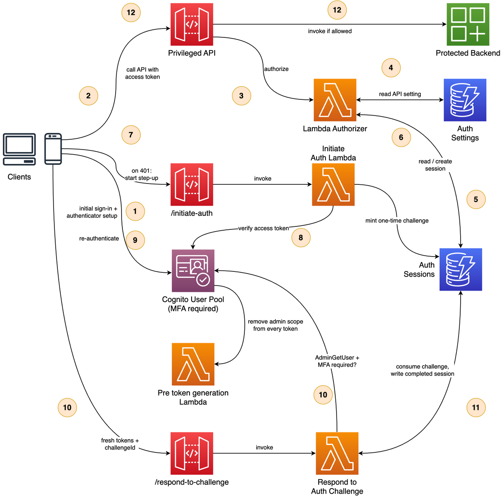
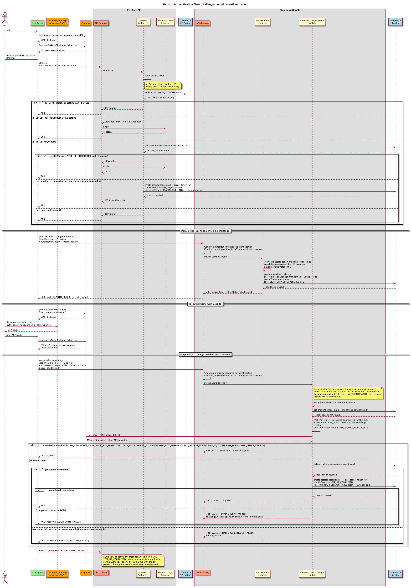
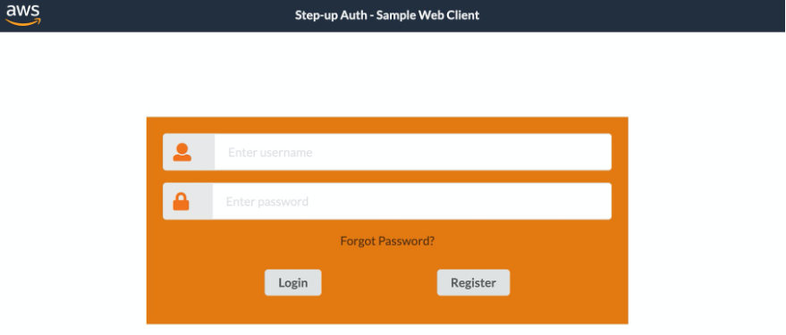
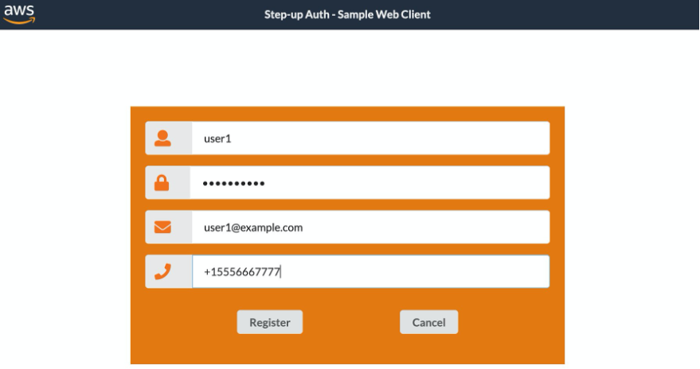
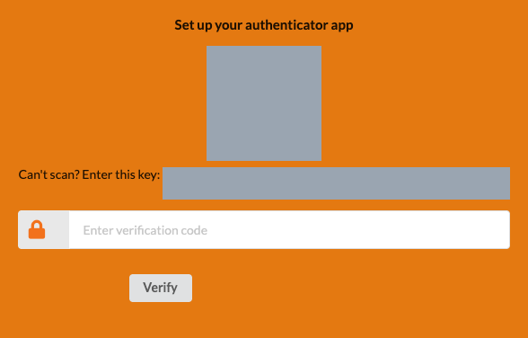
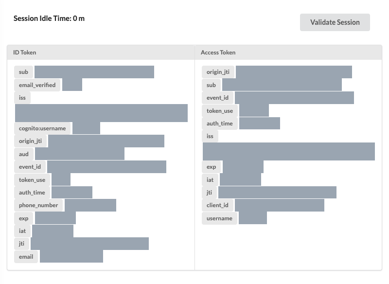
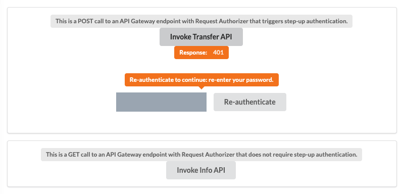
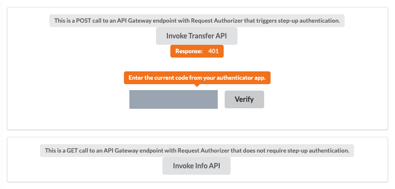
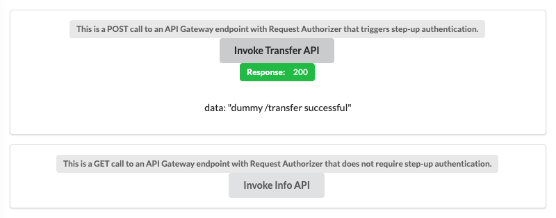

## How to implement Step-up Authentication using Amazon Cognito

> **Security update (November 2026)**
>
> This sample was updated to fix a step-up session expiry defect and other security issues. If you deployed an earlier version, remove it with that version's `deployment/undeploy.sh`, then deploy the latest `main` as a new installation.
>
> - **Session expiry is now enforced in code.** Earlier versions relied on DynamoDB TTL to end a step-up session, and the authorizer didn't check `ttl`. Because DynamoDB can take days to delete expired items, a completed step-up stayed valid until the access token expired (up to 60 minutes by default), whatever `SESSION_TABLE_ITEM_TTL` was set to. The authorizer now rejects a session once its `ttl` has passed, and `ttl` is never later than the access token's expiry.
> - **Step-up now requires a fresh re-authentication.** Earlier versions proved step-up by verifying or enrolling an MFA factor (an MFA enrolment or attribute-verification call) that the holder of a stolen access token could satisfy on its own. Step-up is now a fresh Cognito sign-in (password plus the user's existing MFA) bound to a one-time, server-issued challenge: the completion is accepted only when the freshly authenticated token's `auth_time` falls after the challenge was created, so a stolen access, id or refresh token can no longer complete step-up. See [Initiate Endpoint](#initiate-endpoint) and [Respond to Challenge Endpoint](#respond-to-challenge-endpoint).
> - **Browser tokens can no longer manage MFA, and MFA is required.** Cognito access tokens carry the `aws.cognito.signin.user.admin` scope by default, so in earlier versions the holder of a stolen access token could turn MFA off, register their own authenticator or change the phone number before a step-up re-authentication. A pre token generation Lambda trigger now removes that scope from every access token the user pool issues. The user pool requires MFA with an authenticator app as the only factor: each user sets up the authenticator at first sign-in, and nobody can turn MFA off or change the factor from the app afterwards. The authenticator a step-up re-authentication uses is therefore always the one set up before the step-up challenge. The SMS factor and the web app's Setting page are removed. See [Security model and limitations](#security-model-and-limitations).
> - **Amazon Cognito native step-up.** Amazon Cognito now offers [native step-up authentication with `acr`/`amr` claims](https://docs.aws.amazon.com/cognito/latest/developerguide/cognito-user-pools-step-up-authentication.html) (rolling out); this sample does not depend on it.
> - **Other fixes:** the respond-to-challenge function now waits for the access token signature check and for the session update to be saved. Debug logs redact AWS credentials and tokens. The Lambda role can access only this solution's DynamoDB tables. The authorizer denies requests it can't evaluate, and an API's `STEP_UP_DENY` setting now applies even when the caller has completed step-up.
> - **Deployment hardening:** each Lambda function has its own execution role with only the table and user pool actions it makes, and no role carries an AWS managed policy; API Gateway invokes the functions through Lambda permissions scoped to this API instead of IAM roles.  The API is a regional endpoint with a TLS 1.2 minimum, validates the respond-to-challenge request body, throttles requests, and writes access and execution logs with a 30-day retention.  The CloudFront distribution reads the web bucket through an origin access control, sends anti-framing and HSTS security headers, and writes access logs.  The user pool has an explicit password policy (at least 14 characters).  The unused `token` table and its code are removed.  The authorizer looks up an API's setting by its API Gateway resource path, and the web app no longer writes codes, personal data or the Amplify session to the browser console.  The deployment needs the account's API Gateway CloudWatch Logs role; see [API Gateway logging](#api-gateway-logging).
> - **Platform:** the Lambda functions run on Node.js 24, the deployment uses AWS CDK v2, and the web app uses Amplify JS v6.
> - **If you deployed an earlier version with `NODE_ENV=development`,** its Lambda log groups may contain the functions' temporary AWS credentials and users' tokens. Restrict access to those log groups or delete them.
> - **Blog posts:** the published [Part 1](https://aws.amazon.com/blogs/security/implement-step-up-authentication-with-amazon-cognito-part-1-solution-overview/) and [Part 2](https://aws.amazon.com/blogs/security/implement-step-up-authentication-with-amazon-cognito-part-2-deploy-and-test-the-solution/) describe an earlier version of this solution. Updated versions of Part 1 and Part 2 are being prepared to match this sample. Until they are published, the code and this README are authoritative wherever they differ. The main changes the updated posts will reflect: step-up is now a fresh re-authentication (your password, then your authenticator code) bound to a one-time challenge, rather than entering a one-time code; multi-factor authentication is a TOTP authenticator app that each user sets up at first sign-in, rather than SMS one-time codes or choosing a method on a Setting page; browser access tokens can no longer manage MFA or profile attributes; and DynamoDB TTL only removes old session rows, it doesn't end a step-up session.

This repository contains accompanying source code for the AWS Security Blog posts [Implement step-up authentication with Amazon Cognito, Part 1: Solution overview](https://aws.amazon.com/blogs/security/implement-step-up-authentication-with-amazon-cognito-part-1-solution-overview/) and [Part 2: Deploy and test the solution](https://aws.amazon.com/blogs/security/implement-step-up-authentication-with-amazon-cognito-part-2-deploy-and-test-the-solution/).

We will illustrate how to perform step-up authentication using Amazon API Gateway Lambda Authorizer, Lambda functions, Amazon Cognito and Amazon DynamoDB. Let us first review the architecture in next section.

## Prerequisites

Reference architecture discussed in this blog uses purpose-built Step-Up workflow engine, realized using custom SDK, which leverages Amazon DynamoDB service as persistent layer.  This workflow engine is generic and can be used across any API serving layers, e.g., Amazon API Gateway or Application Load Balancer (ALB), as long as the API serving layers can intercept API requests to perform additional actions.  The Step-Up workflow engine also relies on an identity provider capable of vending out OAuth 2.0 token, i.e., access token.  Therefore, there are three parts to the step-up solution.

1. API Serving Layer with capability to execute custom logic before executing business logic
2. OAuth 2.0 compliant Identity Provider system
3. Purpose-build Step-up Workflow engine

The solution discussed in this blog uses Amazon Cognito as the identity provider, Amazon API Gateway with Authorizer Lambda function to trigger the Step-up workflow engine and DynamoDB Service as persistent layer used by Step-up workflow Engine.  A reference implementation of Amazon API Gateway Authorizer Lambda function is provided in sample code.  Additionally, the purpose-build Step-up Workflow engine provides API’s, /initiate-auth and /respond-to-challenge, realized using Amazon API Gateway and Lambda function, to drive the API invocation step-up state.

Note that if you decide to use API serving layer other than Amazon API Gateway, or use OAuth 2.0 identity provider besides Amazon Cognito, you will have to make changes to accompanying sample code.

## Architecture

The reference architecture is shown below.



Let us traverse how user's API's request are handled by the solution, and how the user state is "elevated" by going through additional challenge before they can successfully invoke a privilege API.

1. It is important to note that user must authenticate with Cognito initially.  As a result, they must have a valid access token generated by Cognito User Pool.  The user pool requires MFA with an authenticator app (TOTP).  At a user's first sign-in, Cognito raises an `MFA_SETUP` challenge and issues no token until the user sets up the authenticator app: the web app shows a QR code and the setup key, and the user confirms with a first code.  Later sign-ins ask for the password and then the authenticator code.  A pre token generation Lambda trigger removes the `aws.cognito.signin.user.admin` scope from every access token the pool issues, so the token works for the sample APIs but can't call Cognito's self-service user operations.
2. User then performs a privileged API invocation and passes access token in Authorization header.
3. The API is protected using a Lambda Authorizer and the invocation triggers Lambda Authorizer.  Authorizer first validates the token using Cognito User Pool public key.  If the Authorization header is missing, the authorizer returns 401.  If the token is invalid, the authorizer returns a deny policy and the caller gets 403.
4. Authorizer performs a look-up in DynamoDB setting table to check whether current request needs elevated privilege (or step-up privilege).  In setting table, you can define which API actions requires elevated privilege.  You can additionally bundle APIs into a group by defining the group attribute.  This allows you to further segregate privileged API's especially in a large-scale deployment.  If the API's setting is `STEP_UP_DENY`, the authorizer returns a deny policy (403), even if the user has completed step-up.  If the API has no setting, or its setting is `STEP_UP_NOT_REQUIRED`, the authorizer allows the call without checking the session table.
5. If API request requires elevated privilege (`STEP_UP_REQUIRED`), Authorizer will check for an existing step-up session for this specific user in session table.  The key for this table will be the “JTI” of the access_token (which can be obtained after token verification).
6. If a completed step-up session (`STEP_UP_COMPLETED`) exists and its `ttl` hasn't passed, then authorization will be given.  Otherwise the authorizer creates a new `STEP_UP_REQUIRED` session for the access_token JTI, and an un-authorized access response (401 HTTP code) will be sent back from lambda authorizer indicating that user requires elevated privilege.
7. Prompted by the 401, the client app calls the /initiate-auth API.  This endpoint is protected by the API Gateway Cognito authorizer, which verifies the ID token passed in the `Identification` header.  The client also passes its access token in the `Authorization` header.
8. The call is forwarded to the initiate Lambda.  The function verifies the caller's access token and requires its `sub` to equal the `sub` of the gateway-verified ID token, so a caller can only start step-up for the user Cognito authenticated (a forged or victim-substituted access token is rejected with 401).  It then mints a one-time, server-bound challenge: a random 128-bit `challengeId`, a `challenge#<challengeId>` row in the session table holding the user's `sub` and a server-set creation time, and a `ttl` of the creation time plus `STEP_UP_CHALLENGE_TTL`.  It returns `{"code":"REAUTH_REQUIRED","challengeId":"..."}`.  The initiate function doesn't read the user's MFA settings and sends no message to the user.
9. Prompted by `REAUTH_REQUIRED`, the client re-authenticates the user with Cognito: it signs the user out locally and signs in again with the password, then completes the MFA challenge Cognito raises with a code from the user's authenticator app.  A wrong password or wrong code can be retried.  This produces a fresh ID token and access token with a new `auth_time`.
10. The client calls the /respond-to-challenge API, passing the fresh access token in the `Authorization` header, the fresh ID token in the `Identification` header and `{"challengeId"}` in the JSON body.  This endpoint is also protected by the Cognito authorizer.  The respond Lambda accepts step-up only when all of these hold: both tokens verify (signature, expiry, issuer, `token_use`, app client) and share the same `sub`; the challenge exists, has not expired and was minted for that `sub`; the access token's `auth_time` is after the challenge creation time (minus a small clock-skew allowance) and within `STEP_UP_MAX_REAUTH_AGE` of now (and not implausibly in the future); Cognito `AdminGetUser` shows a live, enabled user whose `sub` matches the tokens; and Cognito `GetUserPoolMfaConfig` shows the user pool still requires MFA with the authenticator app as its only factor.  Because MFA is required, the fresh sign-in completed MFA with the authenticator set up at the user's first sign-in, before this challenge.  A stolen or merely refreshed token fails the `auth_time` check because its authentication predates the challenge.
11. The function validates first and only then writes.  A failure during validation (bad or mismatched tokens, a missing/expired/wrong-subject challenge, a stale `auth_time`, or a failed user or MFA check) returns a 401 and leaves the session table unchanged.  If every check passes, it consumes the one-time challenge with a single conditional delete (so it cannot be replayed) and *then* writes a `STEP_UP_COMPLETED` row keyed by the **fresh** access token's JTI, with `ttl = min(now + SESSION_TABLE_ITEM_TTL, access token exp)`.  Because the challenge is consumed before the completed row is written, a failure to write that row (`SESSION_WRITE_FAILED`) leaves the challenge already spent, so the user must start a new step-up from /initiate-auth.  Every failure from the respond Lambda returns a short machine-readable `reason` (see [Respond to Challenge Endpoint](#respond-to-challenge-endpoint)).  The two header guards are separate: a missing or invalid `Identification` ID token is rejected by the API Gateway Cognito authorizer (its own 401) before this Lambda runs; once `Identification` is accepted, a missing or malformed `Authorization` bearer token is rejected by the handler with `{"code":"UNAUTHENTICATED"}` and no `reason`.
12. The client re-tries the privileged API with the **fresh** access token.  The authorizer now finds its completed session and allows the call (200) until the `ttl` passes; other protected APIs that require step-up also succeed until then.  The original access token stays un-elevated, so a copy of it cannot ride along on the completed step-up.

These sequences are better illustrated in the sequence diagram below.



## Implementation details

Now let’s talk about the components that make up the step-up auth.

### Step-up authentication data design

Step-up authentication solution relies on two tables, a `session` table and a `setting` table.  The session table contains user's step-up session information where as `setting` table contains an API step-up configuration.  API Gateway Authorizer (discussed in next section), checks `setting` table to determine if API request requires step-up session.  The authorizer creates a `STEP_UP_REQUIRED` entry in the `session` table when an API requires step-up, the initiate function adds a one-time challenge row, and the respond-to-challenge function writes a `STEP_UP_COMPLETED` entry keyed by the freshly re-authenticated access token once step-up succeeds.

A sample record in this table is given below.  Let's go through each attribute:

- sessionId represents the jti claim of user's access token.  A user initiates step-up auth using an access_token that they received from Cognito /token endpoint.  sessionId is the primary key for the table.  The one-time challenge rows that the initiate function writes use `challenge#<challengeId>` as the sessionId instead, so they never collide with an access-token JTI.
- clientId is user's client id present in access_token
- token is an optional field where we can actually store a hashed version of access_token.  By default, however, this field is set to the same value as sessionId
- referrerUrl is the API endpoint that trigger the step-up authentication
- stepUpStatus indicates user's current step-up authentication state
  - STEP_UP_REQUIRED value represents that this user session must provide additional authentication (step-up)
  - STEP_UP_COMPLETED shows that user has gone through the additional authentication challenges and completed step-up authentication flow
  - STEP_UP_ERROR indicates that an error occurred during step-up authentication flow.  This could be caused by user repeatedly failing to complete the additional authentication challenges, or a Cognito error.  The sample functions don't set this value; for an API that requires step-up, the authorizer treats a session in this state like a missing session and starts a new step-up challenge (401).
- userId is extracted from access_token and stored in the table for reference
- createTimestamp represents when this item was created
- lastUpdateTimestamp represents when this session item was last updated.
- ttl is the epoch time (in seconds) at which the row expires.  For a step-up session row it is set to `min(now + SESSION_TABLE_ITEM_TTL, access token exp)`, so a step-up session never outlives the access token it was created for.  `SESSION_TABLE_ITEM_TTL` (seconds) is set on the Authorizer lambda (which writes the `STEP_UP_REQUIRED` row), the respond-to-challenge lambda (which writes the `STEP_UP_COMPLETED` row) and the initiate lambda (which uses the same session-table client).  The CDK deployment sets it from the CDK context value `session_table_item_ttl`, which defaults to 900 seconds (15 minutes) and is validated to the range 60–900.  The `deploy-awscli.sh` scripts of those modules also set it, from the `SESSION_TABLE_ITEM_TTL` environment variable (default 900, range 60–900).  If the variable is missing or out of range, the code falls back to the secure default of 900 seconds and logs a warning.  The one-time challenge row that the initiate lambda writes is separate: its lifetime is governed by `STEP_UP_CHALLENGE_TTL`, not `SESSION_TABLE_ITEM_TTL` (see [Initiate Endpoint](#initiate-endpoint)).
  - Expiry is enforced in code: the authorizer treats a session whose `ttl` is missing or not in the future as expired and starts a new step-up challenge (401).
  - DynamoDB TTL is enabled on this attribute only to delete old rows.  DynamoDB can take up to a few days to delete an expired item, so the deletion is cleanup, not access control.


```json
{
 "sessionId": "11111111-2222-4333-8444-555555555555",
 "clientId": "1example23456789abcdefghij",
 "token": "11111111-2222-4333-8444-555555555555",
 "stepUpStatus": "STEP_UP_REQUIRED",
 "userId": "user1",
 "referrerUrl": "https://abcde12345.execute-api.us-east-2.amazonaws.com/dev/transfer",
 "createTimestamp": "2021-09-19T04:42:39.486Z",
 "lastUpdateTimestamp": "2021-09-19T04:42:39.486Z",
 "ttl": 1632027459
}
```

Next, let us look at the setting table.  Each entry in this table correlate to an API configuration indicating whether a step-up authentication is required.  Two sample API values are shown below to.

- id is the primary key for setting table.  It is the API Gateway resource path of the API, exactly as it is defined in API Gateway, for example `/transfer`.  The authorizer reads it from the `resource` field of the authorizer event, so it doesn't contain the API stage, a custom-domain base path or a trailing slash that the caller added to the request path.  For a resource with path parameters it is the template, for example `/accounts/{accountId}`.
•	stepUpState indicates API’s step-up authentication requirement state
  - STEP_UP_NOT_REQUIRED value indicates no additional authentication is needed for this API.
  - STEP_UP_REQUIRED value indicates that invocation of this API requires additional authentication steps.
  - STEP_UP_DENY value disables any API invocations.  Lambda authorizer returns 403 forbidden error code to the caller, even if the caller has completed step-up authentication.
•	createTimestamp represents when this item was created
•	lastUpdateTimestamp represents when this session item was last updated.


```json
{
 "id": "/info",
 "lastUpdateTimestamp": "2021-08-23T08:25:29.023Z",
 "stepUpState": "STEP_UP_NOT_REQUIRED",
 "createTimestamp": "2021-08-23T08:25:29.023Z"
},
{
 "id": "/transfer",
 "lastUpdateTimestamp": "2021-08-23T08:22:12.436Z",
 "stepUpState": "STEP_UP_REQUIRED",
 "createTimestamp": "2021-08-23T08:22:12.436Z"
}
```

### Authorizer

API Gateway Authorizer is a `REQUEST` type authorizer.  It protects privileged APIs that require step-up session.

Request authorizer ensures that API request contains a valid access token in HTTP Authorization header.  It verifies the token with [aws-jwt-verify](https://github.com/awslabs/aws-jwt-verify): the signature (using the user pool's public keys), expiry, issuer, `token_use` (must be `access`) and `client_id` (must match the `COGNITO_CLIENT_ID` environment variable).  A request without an Authorization header gets a 401 response, and a token that fails verification gets a `deny` policy (403).

Authorizer then looks up the `settings` table for the API configuration, using the API Gateway resource path of the called method (the event's `resource`, for example `/transfer`) as key.  This is the resource whose method the authorizer's `allow` policy grants, so a variant of the request path (a trailing slash, for example) can't miss the setting; an event without a resource path gets a `deny` policy (403).  If API configuration in settings table is set to `STEP_UP_DENY`, authorizer will return `deny` [API Gateway Authorizer Policy](https://docs.aws.amazon.com/apigateway/latest/developerguide/api-gateway-lambda-authorizer-output.html) hence blocking the API invocation; caller will see a 403 forbidden error.  This applies even when the caller has completed step-up authentication.  If `settings` table has no item for the API path, or the `stepUpState` field is set to `STEP_UP_NOT_REQUIRED`, authorizer lets the call through by generating an `allow` [API Gateway Authorizer Policy](https://docs.aws.amazon.com/apigateway/latest/developerguide/api-gateway-lambda-authorizer-output.html); it doesn't read or write the `sessions` table.  If `settings` table can't be read, or the item holds any other `stepUpState` value, authorizer returns a `deny` policy (403).

If the `stepUpState` field in `settings` table is set to `STEP_UP_REQUIRED`, it indicates that user must provide additional authentication in order to call this api.  In this case, using access token's JTI claim as key, authorizer attempts to retrieve a step-up `session` from `sessions` table.  If the session's `stepUpStatus` field is set to `STEP_UP_COMPLETED` and its `ttl` is still in the future, authorizer lets the API call through with an `allow` policy.  In every other case (no session, a `ttl` that has passed or is missing, or any other `stepUpStatus`, such as `STEP_UP_REQUIRED` while a challenge is pending), authorizer will create a new `session` in `sessions` table using access token's JTI claim as session key, with `stepUpStatus` set to `STEP_UP_REQUIRED`; it will return a 401 challenge to the caller.  If `sessions` table can't be read, or the new `STEP_UP_REQUIRED` session can't be written, authorizer returns a `deny` policy (403).

Authorizer uses purpose build `auth-sdk` code to interface with both `sessions` and `settings` DynamoDB tables.  `auth-sdk` stream-lines CRUD operations on tables by providing convenience methods to create/update/delete items in tables.  Under the hood, `auth-sdk` uses [DynamoDB v3 client sdk](https://docs.aws.amazon.com/AWSJavaScriptSDK/v3/latest/clients/client-dynamodb/index.html).

### Initiate Endpoint

The initiate endpoint is called by the frontend after the API Gateway returns a 401, to start the step-up flow.  Its role is to mint a one-time, server-bound challenge that the user will later prove they can satisfy by re-authenticating.  It does **not** read the user's MFA configuration and sends no message to the user.

The endpoint requires no body parameters.  It is protected by the API Gateway Cognito authorizer, which verifies the Cognito ID token passed in the `Identification` header; the client also passes its access token in the `Authorization` header.  The Lambda cryptographically verifies that access token and requires its `sub` to equal the `sub` of the gateway-verified ID token.  Because the challenge subject comes from the gateway-verified ID token, not from the unverified `Authorization` value, a caller can only mint a challenge for the exact user Cognito authenticated; a forged or victim-substituted access token is rejected with a generic 401.

It then creates a challenge record in the session table: a random 128-bit `challengeId`, a `challenge#<challengeId>` row holding the caller's `sub` and a server-set creation time, with `ttl` equal to the creation time plus `STEP_UP_CHALLENGE_TTL` (default 600 seconds; see [Step-up configuration](#step-up-configuration)).  The creation time — not the ttl — is the load-bearing control: the respond-to-challenge endpoint accepts step-up only when the fresh token's `auth_time` is after it.  The endpoint returns `{"code":"REAUTH_REQUIRED","challengeId":"..."}`.

### Respond to Challenge Endpoint

The respond-to-challenge endpoint completes step-up.  Step-up is proven by a *fresh re-authentication that this step-up request prompted*, not by verifying or enrolling an MFA factor.  Prompted by `REAUTH_REQUIRED`, the client re-authenticates the user with Cognito (the password, then a code from the authenticator app the user set up at first sign-in), which yields a fresh ID token and access token.  The client then calls this endpoint with the fresh access token in the `Authorization` header, the fresh ID token in the `Identification` header and `{"challengeId"}` (from /initiate-auth) in the JSON body.  Like initiate, it is protected by the Cognito authorizer.

The Lambda accepts step-up only when all of the following hold:

- both the access token and the ID token verify (signature, expiry, issuer, `token_use`, app client id/aud);
- both tokens belong to the same user (`sub` binding);
- the one-time challenge for the presented `challengeId` exists, has not expired and was minted for that same `sub`;
- the access token's `auth_time` is strictly after the challenge's creation time, allowing only `STEP_UP_CHALLENGE_CLOCK_SKEW` seconds of clock skew — a stolen or merely refreshed token, whose authentication predates the challenge, is rejected here;
- the authentication is recent: `auth_time` is within `STEP_UP_MAX_REAUTH_AGE` of now, and not more than `STEP_UP_REAUTH_FUTURE_SKEW` seconds in the future;
- Cognito [AdminGetUser](https://docs.aws.amazon.com/cognito-user-identity-pools/latest/APIReference/API_AdminGetUser.html) returns the token's user, the user is not disabled, and the user's `sub` attribute equals the tokens' `sub`; otherwise, or if the call fails, the reason is `MFA_CHECK_FAILED`;
- Cognito [GetUserPoolMfaConfig](https://docs.aws.amazon.com/cognito-user-identity-pools/latest/APIReference/API_GetUserPoolMfaConfig.html) shows the user pool requires MFA (`MfaConfiguration` `ON`) with the software token (authenticator app) enabled and no SMS or email MFA; otherwise the reason is `MFA_NOT_ENROLLED`, and if the call fails, `MFA_CHECK_FAILED`.  Because the pool requires MFA and no token can change a user's factor, the fresh sign-in completed MFA with the authenticator the user set up at first sign-in, which predates the challenge.  The function doesn't use the per-user MFA list that `AdminGetUser` returns: Cognito leaves it empty for a user who set up the authenticator through the first sign-in `MFA_SETUP` challenge, although the pool still requires that user's authenticator code at every sign-in.

These two calls use the respond-to-challenge function's role, which may call `cognito-idp:AdminGetUser` and `cognito-idp:GetUserPoolMfaConfig` on this user pool only.  The function reads the pool id from its `USER_POOL_ID` environment variable and fails closed with `MFA_CHECK_FAILED` if it is missing, isn't a user pool id, or names a different pool than `COGNITO_USER_POOL_ARN`.

The checks run in that order, and the `sessions` table is written only after they all pass.  A validation failure returns a 401, leaves the `sessions` table unchanged, and carries a short machine-readable `reason` — one of `NO_CHALLENGE`, `CHALLENGE_SUB_MISMATCH`, `STALE_AUTH`, `TOKEN_MISMATCH`, `MFA_NOT_ENROLLED`, `BAD_ACCESS_TOKEN`, `BAD_ID_TOKEN`, `BAD_TOKEN` or `MFA_CHECK_FAILED` — that never reveals a secret.  When every check passes, the function consumes the one-time challenge with a single conditional delete (so replaying the same challenge cannot complete a second time) and *then* writes a `STEP_UP_COMPLETED` row keyed by the **fresh** access token's JTI with `ttl = min(now + SESSION_TABLE_ITEM_TTL, access token exp)`.  Two more `reason` codes come from this final stage and are not symmetric with the validation failures: `CHALLENGE_CONSUME_FAILED` means the conditional delete didn't succeed (for example a concurrent completion consumed the challenge first), so nothing is written; `SESSION_WRITE_FAILED` means the challenge was already consumed but the completed row couldn't be written, which leaves the challenge spent and requires the user to start a new step-up from /initiate-auth.  Separately, the endpoint has two header guards.  The API Gateway Cognito authorizer validates the `Identification` ID token, so a missing or invalid `Identification` token is rejected by the gateway's authorizer with a 401 before this Lambda runs.  Once `Identification` is accepted, a request whose `Authorization` bearer token is missing or malformed is rejected by the handler before the responder runs, with a 401 body of `{"code":"UNAUTHENTICATED"}` and no `reason`.  API Gateway also validates a JSON request body against a model before the Lambda runs: the body must be a JSON object, and its `challengeId`, when present, must be the 32-character lower-case hex id that /initiate-auth returns.  Any other JSON body gets a 400 `Invalid request body` from the gateway.  A body without `challengeId` passes the model and gets the 401 `NO_CHALLENGE` reason from the Lambda.  A completed session is valid until its `ttl` passes; after that, the authorizer treats it as expired.  DynamoDB TTL deletes the item later, which can take a few days.

The step-up proof no longer verifies or enrols an MFA factor, and the earlier one-time-code calls and their MFA method codes are gone.  A user sets up MFA once, at first sign-in: Cognito's `MFA_SETUP` challenge calls `AssociateSoftwareToken` and `VerifySoftwareToken` with the sign-in session, not with an access token, and only then issues tokens.  After that, the user can't change or turn off MFA: the web app has no MFA settings page, the sample has no MFA API, and the access tokens lack the scope that Cognito's own MFA operations require.  See [Security model and limitations](#security-model-and-limitations).

### Step-up configuration

The step-up timing and session parameters are Lambda environment variables with secure defaults and validated ranges.  A Lambda that receives a missing or out-of-range value logs a warning that names the variable (never the value) and falls back to the default, so a bad value can never widen a security window.  The CDK context parser validates the same ranges and fails the deployment on an invalid value.  Set them through CDK context, the `deploy.sh` / `undeploy.sh` environment variables, or the per-module `deploy-awscli.sh` scripts.

| Variable | Set on | CDK context key | Default | Range (seconds) | Purpose |
|---|---|---|---|---|---|
| `STEP_UP_CHALLENGE_TTL` | initiate | `step_up_challenge_ttl` | 600 | 60–900 | Lifetime of a one-time challenge; it only needs to outlive the user's re-authentication. |
| `STEP_UP_CHALLENGE_CLOCK_SKEW` | respond-to-challenge | `step_up_challenge_clock_skew` | 1 | 0–10 | Clock-skew allowance for the "authenticated after the challenge" check.  Kept tiny; widening it would re-open the stolen-token window. |
| `STEP_UP_REAUTH_FUTURE_SKEW` | respond-to-challenge | `step_up_reauth_future_skew` | 5 | 0–10 | Allowance for an `auth_time` slightly ahead of the Lambda's clock. |
| `STEP_UP_MAX_REAUTH_AGE` | respond-to-challenge | `step_up_max_reauth_age` | 120 | 30–900 | How recent the re-authentication must be.  The floor keeps it usable for a real password + MFA sign-in; the ceiling stops it becoming a long replay window. |
| `SESSION_TABLE_ITEM_TTL` | initiate, respond-to-challenge, authorizer | `session_table_item_ttl` | 900 | 60–900 | Step-up session lifetime (`STEP_UP_REQUIRED` and `STEP_UP_COMPLETED` rows); the row `ttl` is also capped at the access token's expiry. |

`SESSION_TABLE_ITEM_TTL` does not affect the challenge lifetime: the initiate function derives the challenge `ttl` from `STEP_UP_CHALLENGE_TTL` alone.  Setting it on the initiate function only silences the fallback warning from the shared session-table client.

### Deployment

This solution can be deployed using CDK and it will create a working reference implementation that you can use for demonstration and learning purposes.  There are a few prerequisites to deployment.

1. Install [Node.js](https://nodejs.org/en/) 24 and npm 11 in your environment.  You can use a [package manager](https://nodejs.org/en/download/package-manager/#macos) for your platform to install these.  The Lambda functions run on the `nodejs24.x` runtime.  Use Node.js 24 for every project in this repository.  The library and Lambda projects (`auth-utils`, `auth-sdk`, `step-up-authorizer`, `step-up-challenge`, `step-up-initiate` and `sample-api`) declare `engines.node >=24` in their `package.json`; the `deployment` and `sample-web-app` projects don't declare an `engines` field.  Check with `node -v` and `npm -v`.
2. Review the [CDK v2 getting started guide](https://docs.aws.amazon.com/cdk/v2/guide/getting-started.html).  You don't need a global CDK install: the `deployment` project pins the CDK CLI (`aws-cdk` 2.x) and the scripts run `./node_modules/.bin/cdk`.  The target account and region must be [bootstrapped](https://docs.aws.amazon.com/cdk/v2/guide/bootstrapping.html) for CDK v2; `deploy.sh` runs `cdk bootstrap` for you.
3. Install the [AWS CLI](https://docs.aws.amazon.com/cli/latest/userguide/getting-started-install.html).  `deploy.sh` uses it to upload the web app to S3 and invalidate the CloudFront cache.

CDK will create several resources in your account as below:

- Amazon Cognito User pool that is used as user registry.  It requires MFA with the authenticator app (software token) as the only factor, has no SMS factor, requires `email` and `phone_number` at registration and doesn't remember devices.  It uses the Essentials feature plan, which the pre token generation trigger needs.
- A pre token generation Lambda trigger (event version V2_0, inline code in `deployment/lib/infrastructure/pre-token-generation.ts`) that removes the `aws.cognito.signin.user.admin` scope from every access token the user pool issues.  It has its own role, which can only write the trigger's log group.
- API Gateway API containing four resources,
  - two sample resources protected by the Lambda authorizer: `/transfer` (POST), which requires step-up authentication once you add its setting (see [Testing Step-up Solution](#testing-step-up-solution)), and `/info` (GET)
  - initiate-auth resource to trigger the step-up challenge response
  - respond-to-challenge resource to complete step-up challenge
  - a regional endpoint with the `SecurityPolicy_TLS13_1_2_2021_06` security policy (TLS 1.2 and 1.3) and the `BASIC` endpoint access mode, and a `dev` stage that throttles requests (10 per second, burst of 20) and writes JSON access logs and `ERROR`-level execution logs to CloudWatch Logs log groups with a 30-day retention
- Lambda authorizer that is used to protect APIs
- One IAM execution role and one CloudWatch Logs log group (30-day retention) for each of the four Lambda functions.  A role has no AWS managed policy and allows only the table and user pool actions its function makes.  API Gateway calls the functions through Lambda permissions scoped to this API; no IAM role is assumed by API Gateway.
- DynamoDB tables
  - `settings` table that holds configuration mapping of the APIs that require elevated privileges
  - `sessions` table that holds temporary, user-initiate step-up sessions and their current status.
- A React WebUI that demonstrates how to invoke a privileged API and go through step-up authentication.  It is served by a CloudFront distribution from a private S3 bucket through an origin access control, with security response headers (`X-Frame-Options: DENY`, `Content-Security-Policy: frame-ancestors 'none'`, HSTS and `X-Content-Type-Options: nosniff`).  A second, private S3 bucket receives the CloudFront access logs and the web bucket's server access logs, and deletes them after 30 days.

Prior to deploying the solution, build the necessary resources first.  Use the accompanying `build.sh` script in the `deployment` folder.  It runs `npm ci` in every project (so each `package-lock.json` must be in sync with its `package.json`), builds the `auth-utils` and `auth-sdk` libraries, packages the four Lambda functions into zip files under `source/<module>/build/compressed/`, and writes a CycloneDX software bill of materials to `source/<module>/build/sbom/<module>.cdx.json` (with `npm sbom`).  A Lambda function's SBOM lists every package in its zip file, including the dependencies of the bundled `auth-utils` and `auth-sdk` libraries; the web app's lists its production dependencies.  Simply trigger the build script from a terminal window as follows:

```sh
cd deployment && npm ci && ./build.sh
```

To run the lint checks and unit tests of a backend project (for example `source/step-up-authorizer`), install it and link the two local libraries first.  `npm ci` removes npm links, so link after installing, and link both libraries in one command:

```sh
(cd source/auth-utils && npm ci && npm link)
(cd source/auth-sdk && npm ci && npm link && npm link @step-up-auth/auth-utils)
cd source/step-up-authorizer && npm ci && npm link @step-up-auth/auth-sdk @step-up-auth/auth-utils
npm run lint-dev && npm run build-ts-prod && npm test
```

The CDK project has its own checks: `cd deployment && npm run lint && npm run build && npm test`.

Now let us deploy the solution using `deploy.sh` script present in the `deployment` folder.  Set the required environment variables first:

```sh
export AWS_REGION=us-east-1
export AWS_ACCOUNT=<your account number>
export AWS_PROFILE=<valid profile in .aws/credentials that contains secret/access key to your account>
export NODE_ENV=development
export ENV_PREFIX=dev
```

`AWS_ACCOUNT` is used to bootstrap CDK deployment (`cdk bootstrap aws://$AWS_ACCOUNT/$AWS_REGION`).  You must have AWS credentials files containing a profile with your account secret key and access key in order to do the deployment; set `AWS_PROFILE` to point to you profile.  Ensure that your account has enough privileges to create/update/delete following resources:

- Amazon Cognito
- Amazon API Gateway API and resources
- Amazon S3 Bucket
- AWS CloudFront distribution
- Amazon DynamoDB tables
- AWS Lambda functions
- Amazon CloudWatch Logs log groups
- IAM Roles

#### API Gateway logging

The API stage writes access and execution logs to CloudWatch Logs.  API Gateway writes them with the account's API Gateway CloudWatch Logs role, which is a single setting for each account and region that every REST API in that region shares.  The deployment doesn't create or replace that role, because replacing it would change the logging of the account's other APIs.  `deploy.sh` checks that it is set and stops with exit code 7 if it isn't.  Check it with:

```sh
aws apigateway get-account --region "$AWS_REGION" --query cloudwatchRoleArn --output text
```

If the output is empty or `None`, set it once for the account and region: create an IAM role that `apigateway.amazonaws.com` can assume, attach the AWS managed policy `service-role/AmazonAPIGatewayPushToCloudWatchLogs`, and set the role in the API Gateway account settings (see [Set up CloudWatch logging for REST APIs](https://docs.aws.amazon.com/apigateway/latest/developerguide/set-up-logging.html)):

```sh
aws apigateway update-account --region "$AWS_REGION" \
  --patch-operations op=replace,path=/cloudwatchRoleArn,value=<role ARN>
```

`NODE_ENV` can be set to `development` or `production`.  It controls the log output that Lambda functions generates (see [Logging](#logging) below).  And `ENV_PREFIX` tags resources with an environment name: it is appended to the DynamoDB table names (for example `step-up-auth-session-dev`) and passed to the Lambda functions, which use it to find the tables.  The CloudFormation stack names and the web bucket name (`step-up-auth-web-ui-<account>-<region>`) don't include it, so you can deploy only one copy of the solution per account and region.

The following environment variables are optional:

- Step-up timing and session variables: `SESSION_TABLE_ITEM_TTL`, `STEP_UP_CHALLENGE_TTL`, `STEP_UP_CHALLENGE_CLOCK_SKEW`, `STEP_UP_REAUTH_FUTURE_SKEW` and `STEP_UP_MAX_REAUTH_AGE`.  `deploy.sh` / `undeploy.sh` forward each one it sees to the matching CDK context key, and the deployment fails on an out-of-range value.  If a variable is unset, the deployment uses that setting's secure default.  For the exact defaults, validated ranges, CDK context keys and which Lambda functions each one is set on, see the single canonical [Step-up configuration](#step-up-configuration) table above — for example `SESSION_TABLE_ITEM_TTL` defaults to 900 seconds, is bounded to 60–900, and is set on the initiate, respond-to-challenge and authorizer functions.
- `CDK_TAGS`: space-separated `key=value` pairs, for example `CDK_TAGS="project=step-up-auth owner=me"`.  Each pair is passed as `--tags key=value` to both `cdk bootstrap` and `cdk deploy`.
- `CDK_OUTPUTS_FILE`: path of a file that keeps the stack outputs (user pool id, app client id, API stage URL, bucket name, CloudFront domain) after the script exits.  Without it, the outputs go to a temporary file that is deleted when the script ends.

Finally, trigger the stack deploying:

```sh
cd deployment && ./deploy.sh
```

`deploy.sh` checks the API Gateway CloudWatch Logs role, then runs an incremental build, `cdk bootstrap`, `cdk deploy --all` (5 CloudFormation stacks), then builds the web app with the stack outputs and uploads it to the web bucket.  Before the upload it checks that the account of your AWS credentials owns the web bucket, and stops if it doesn't.  The last line of the output, `Sample Web App URL: <domain>`, shows the CloudFront distribution domain name.  Open `https://<domain>` to load the sample web app.

To remove the solution, use `undeploy.sh` with the same `AWS_REGION`, `AWS_ACCOUNT`, `NODE_ENV` and `ENV_PREFIX` values (and `AWS_PROFILE` for credentials):

```sh
cd deployment && ./undeploy.sh
```

`undeploy.sh` runs `cdk destroy --all --force`.  CDK synthesizes the app first, so the Lambda zip files from `build.sh` must still be under `source/<module>/build/compressed/`.  The Cognito user pool, the DynamoDB tables, the two S3 buckets and the log groups use a `DESTROY` removal policy, so this deletes the Cognito user pool (and its users), the DynamoDB tables (and their items), the web bucket and the access-log bucket (and their objects), and the log groups of the five Lambda functions (the four step-up functions and the pre token generation trigger) and of the API stage.  `undeploy.sh` doesn't remove the CDK bootstrap stack (`CDKToolkit`), or the account's API Gateway CloudWatch Logs role, which the deployment doesn't create.

One log group stays behind: the CDK helper function that empties the two buckets on delete gets a log group that Lambda creates itself, outside the stack.  Its name starts with `/aws/lambda/StepUpAuth`, and so do the retained log groups of an earlier version of this sample deployed in the same account and region.  List them, check that the list holds only log groups you want to remove, then delete them:

```sh
aws logs describe-log-groups --region "$AWS_REGION" --log-group-name-prefix /aws/lambda/StepUpAuth \
  --query 'logGroups[].logGroupName' --output text
for group in $(aws logs describe-log-groups --region "$AWS_REGION" --log-group-name-prefix /aws/lambda/StepUpAuth \
    --query 'logGroups[].logGroupName' --output text); do
  aws logs delete-log-group --region "$AWS_REGION" --log-group-name "$group"
done
```

Deleting a log group permanently deletes its log events.

#### Logging

The Lambda functions log at `debug` level when `NODE_ENV=development` and at `warn` level (warnings and errors only) when `NODE_ENV=production`.  Debug logs include the environment, the incoming event and decoded token claims, but sensitive values are redacted:

- Only the values of the sample's own settings (the `COGNITO_*`, `USER_POOL_ID`, `ENV_PREFIX`, `SESSION_TABLE_ITEM_TTL` and `STEP_UP_*` variables) and of the Lambda runtime's non-secret variables (for example `AWS_REGION` and `AWS_LAMBDA_FUNCTION_NAME`) are logged.  Every other environment variable, including `AWS_ACCESS_KEY_ID`, `AWS_SECRET_ACCESS_KEY` and `AWS_SESSION_TOKEN`, is logged as `<redacted>`, whatever its name.
- A JWT is never logged in full.  It is replaced with a summary: the first 12 characters, the header `kid`/`alg`, and the claims `sub`, `username`, `cognito:username`, `jti`, `exp`, `iat`, `token_use`, `scope`, `client_id` and `aud`.
- `Authorization`, `Identification`, `Proxy-Authorization`, `Cookie`, `Set-Cookie`, `X-Api-Key` and `X-Amz-Security-Token` header values are replaced with the JWT summary (for a bearer JWT) or `<masked>`.
- The request body is logged as `<masked>`, and the claims that API Gateway's Cognito authorizer adds to the event (`requestContext.authorizer.claims`) keep only `sub`, `cognito:username`, `token_use`, `aud`, `iss`, `exp`, `iat` and `auth_time`, so the email address and phone number are not logged.
- The Lambda context is not logged, only its request id.

Some personal data still appears: the JWT summary and the kept claims include user identifiers (`sub`, `username` / `cognito:username`), so a `debug` log identifies the authenticated user even though the raw token and its other claims are not logged.

The API stage's access log has one JSON line per request (request id, caller IP, method, resource path, status, response length and time) and no headers or bodies.  Its execution log records errors only (`ERROR` level) and has data tracing turned off, so it never contains the request or response.

The web app logs only fixed messages, sign-in and sign-up step names and Redux action types to the browser console.  It doesn't log codes, passwords, user names, email addresses, phone numbers, tokens or the Amplify session.  A production build (`npm run build`) turns `console.log` off.

For local debugging outside Lambda, `LOG_RAW_SECRETS=true` turns redaction off.  It has no effect inside Lambda (when `AWS_LAMBDA_FUNCTION_NAME` is set).

#### Run the web app locally

You can also run the sample web app on your machine against a deployed backend.  Take the values from the stack outputs (`UserPoolId`, `UserPoolClientId`, `StageUrl`):

```sh
cd source/sample-web-app && npm ci
npm start -- --env USER_POOL_ID=<UserPoolId> --env CLIENT_ID=<UserPoolClientId> \
  --env API_GATEWAY_API_NAME=step-up-auth --env API_GATEWAY_API_ENDPOINT=<StageUrl> --env AWS_REGION=<your region>
```

Open http://127.0.0.1:8080 in your browser.  The development server listens on `127.0.0.1:8080` only, so other machines can't reach it, and it fails to start if port 8080 is already in use.  The development server also writes a development build into `dist/`, so before you upload `dist/`, rebuild it with `./build.sh` (it needs `AWS_REGION`, `COGNITO_USER_POOL_ID`, `COGNITO_CLIENT_ID`, `API_GATEWAY_API_NAME` and `API_GATEWAY_API_ENDPOINT`), or run `deployment/deploy.sh`, which rebuilds and uploads it.  A plain `npm run build` leaves these settings empty.  The web app's own checks are `npm run lint && npm run test-unit && npm run build`.

### Testing Step-up Solution

The deployment creates the setting table (`step-up-auth-setting-<ENV_PREFIX>`, for example `step-up-auth-setting-dev`) empty.  Until you add a setting for an API, that API doesn't require step-up: the authorizer still requires a valid access token for every call to /info and /transfer, but it allows the call without a step-up session.  Add one item per API that you want to configure.  Each item has these attributes, all of type String:

| Attribute | Value |
|---|---|
| `id` (partition key) | The API Gateway resource path of the API, exactly as defined in API Gateway: `/transfer` or `/info`.  No stage (`/dev`), no host name, no trailing slash. |
| `stepUpState` | `STEP_UP_REQUIRED` (the API needs a completed step-up), `STEP_UP_NOT_REQUIRED` (it doesn't) or `STEP_UP_DENY` (every call is refused with 403).  Any other value is treated as `STEP_UP_DENY`. |
| `createTimestamp`, `lastUpdateTimestamp` | ISO 8601 times, for information only; the authorizer doesn't read them. |

For this walkthrough, the sample /transfer API requires step-up and the sample /info API doesn't.  In the DynamoDB console, open the `step-up-auth-setting-<ENV_PREFIX>` table, choose **Explore table items**, then **Create item**, switch to the JSON view with **View DynamoDB JSON** turned off, and create these two items one at a time:

```json
{
 "id": "/info",
 "lastUpdateTimestamp": "2021-08-23T08:25:29.023Z",
 "stepUpState": "STEP_UP_NOT_REQUIRED",
 "createTimestamp": "2021-08-23T08:25:29.023Z"
}
```

```json
{
 "id": "/transfer",
 "lastUpdateTimestamp": "2021-08-23T08:22:12.436Z",
 "stepUpState": "STEP_UP_REQUIRED",
 "createTimestamp": "2021-08-23T08:22:12.436Z"
}
```

Or create them with the AWS CLI (with the same `AWS_REGION` and `ENV_PREFIX` as the deployment):

```sh
now="$(date -u +%Y-%m-%dT%H:%M:%SZ)"
aws dynamodb put-item --region "$AWS_REGION" --table-name "step-up-auth-setting-${ENV_PREFIX}" \
  --item "{\"id\":{\"S\":\"/info\"},\"stepUpState\":{\"S\":\"STEP_UP_NOT_REQUIRED\"},\"createTimestamp\":{\"S\":\"$now\"},\"lastUpdateTimestamp\":{\"S\":\"$now\"}}"
aws dynamodb put-item --region "$AWS_REGION" --table-name "step-up-auth-setting-${ENV_PREFIX}" \
  --item "{\"id\":{\"S\":\"/transfer\"},\"stepUpState\":{\"S\":\"STEP_UP_REQUIRED\"},\"createTimestamp\":{\"S\":\"$now\"},\"lastUpdateTimestamp\":{\"S\":\"$now\"}}"
```

The authorizer reads the setting on every call (it doesn't cache it), so a change applies to the next request.  If you add your own API, add its setting item before you rely on it requiring step-up.

Launch your web browser and load the CloudFront URL.  You will be presented with a login screen.



Register a new user.  The password must have at least 14 characters, with a lower-case letter, an upper-case letter, a digit and a symbol.  The user pool requires an email address and a phone number at registration.  Use an email address you can receive mail at: Cognito emails a verification code that you must enter to confirm the account.  The phone number is only a profile attribute, not an MFA factor: the user pool has no SMS factor.  The default Cognito email sender is for testing only and has a low [daily sending limit](https://docs.aws.amazon.com/cognito/latest/developerguide/limits.html); for automated tests, create users with the [admin-create-user](https://docs.aws.amazon.com/cli/latest/reference/cognito-idp/admin-create-user.html) API (with `--message-action SUPPRESS`) and set a password with `admin-set-user-password`, which send no email.



You are returned to the login screen.  Log in with the user you just registered.  Because the user pool requires MFA, the first sign-in asks you to set up an authenticator app: scan the QR code with the app, or enter the setup key shown under it, then enter the code the app shows and select Verify.



Cognito issues your tokens only after this step, and you reach the welcome screen.  It lists the claims in your ID token and access token.  The access token has no `scope` claim, because the pre token generation trigger removes `aws.cognito.signin.user.admin`, which was the only scope on this sample's sign-in tokens.  Later sign-ins ask for your password and then the code from the authenticator app.  The web app has no page for changing or removing the authenticator; see [Security model and limitations](#security-model-and-limitations).



Go into the StepUp Auth menu and choose Invoke Transfer API.  Because /transfer requires step-up, you get a 401 and the app starts step-up by asking you to re-authenticate, beginning with your password.



Re-enter your password and select Re-authenticate.  The app signs you back in with Cognito, which raises your MFA challenge and asks for the current code from your authenticator app.



Enter the MFA code and select Verify.  The app sends the fresh tokens and the one-time challenge id to the respond-to-challenge endpoint; on success it shows "Complete! Invoke API again."  Select Invoke Transfer API again, and with the fresh, elevated access token the call now succeeds.



Congratulations!  You've successfully performed a step-up authentication.

The step-up session ends after `SESSION_TABLE_ITEM_TTL` seconds (900 by default), or earlier if the access token expires first.  After that, Invoke Transfer API returns 401 again and you re-authenticate to start a new step-up.  Re-authentication always prompts for MFA, because the user pool does not remember devices.

## Additional considerations

This solution calls several Amazon Cognito APIs.  Cognito applies [rate limits per API category](https://docs.aws.amazon.com/cognito/latest/developerguide/limits.html#category_operations), and calls that exceed the assigned quota are throttled.

Because step-up now re-authenticates the user, the Cognito calls on the step-up path are the sign-in operations [InitiateAuth and RespondToAuthChallenge](https://docs.aws.amazon.com/cognito-user-identity-pools/latest/APIReference/API_InitiateAuth.html) (the user-authentication category) performed by the client during re-authentication, and two calls the respond-to-challenge function makes: [AdminGetUser](https://docs.aws.amazon.com/cognito-user-identity-pools/latest/APIReference/API_AdminGetUser.html) (the user-read category) and [GetUserPoolMfaConfig](https://docs.aws.amazon.com/cognito-user-identity-pools/latest/APIReference/API_GetUserPoolMfaConfig.html) (the user-pool-resource-read category).  A user's first sign-in also calls `AssociateSoftwareToken` and `VerifySoftwareToken` (the user-resource-update category) to set up the authenticator app.  The earlier one-time-code calls are no longer on the step-up path.  Each category has its own quota, so the effective throughput of a protected API is bounded by the lowest quota among the categories its step-up flow touches.  Check your account's current quotas in the Service Quotas console rather than assuming a fixed requests-per-second figure, and note that the Cognito email sender has its own [sending limits](https://docs.aws.amazon.com/cognito/latest/developerguide/limits.html).

## Security model and limitations

Step-up must accept only an MFA factor that was set up before the step-up challenge.  Cognito doesn't record when a user's MFA factor was set up, so the respond-to-challenge function can't compare a factor-setup time with the challenge time.  The sample makes the property hold by construction instead:

- **No browser token can manage MFA or user attributes, on any path.**  A pre token generation Lambda trigger removes the `aws.cognito.signin.user.admin` scope from every access token the user pool issues: at sign-in, at the step-up re-authentication, after a new-password challenge and on a token refresh.  The trigger has no exceptions.  Without that scope, an access token can't call the Cognito operations that a user authorizes with their own access token, such as `AssociateSoftwareToken`, `VerifySoftwareToken`, `SetUserMFAPreference`, `UpdateUserAttributes` or `GetUser`.  The sample APIs don't need the scope.
- **MFA is required, and set up once at first sign-in.**  The user pool requires MFA with the authenticator app (TOTP) as the only factor.  Cognito issues no token until the user has set up the authenticator through the first sign-in `MFA_SETUP` challenge, which uses the sign-in session, not an access token.  After that, MFA can't be turned off, and the sample has no page or API that registers or replaces a factor.
- **So the factor always predates the challenge.**  The authenticator that a step-up re-authentication uses is the one set up at first sign-in, before any step-up challenge existed.  The respond-to-challenge function also checks the user pool on every completion and refuses step-up if the pool no longer requires MFA with the authenticator app only, so a pool whose MFA setting drifts fails closed.

What this step-up design protects against:

- Completing step-up with a **stolen access, ID or refresh token**, because completion requires a fresh re-authentication whose `auth_time` falls after the one-time challenge, and a stolen or refreshed token's authentication predates it.
- **Preparing a stolen access token for step-up** by first turning the user's MFA off, registering the attacker's own authenticator in place of the user's, or changing the user's phone number.  The token has no `aws.cognito.signin.user.admin` scope, so Cognito rejects each of these calls.  The phone number isn't an MFA factor either, because the user pool has no SMS factor.
- Using **another user's ID token**: the initiate and respond endpoints bind both the challenge and the presented tokens to a single `sub`.
- **Replaying a challenge**: the challenge is one-time and is consumed with a single conditional delete on success.

What it does **not** protect against (state these plainly to anyone deploying it):

- **The first factor (the password) before first sign-in.**  Someone who learns the user's password between account creation and the user's first sign-in can sign in first and set up their own authenticator.  Deliver initial passwords over a trusted channel and keep this window short.
- An access token stolen **after** step-up completes is elevated until the step-up session `ttl` or the token's own expiry, whichever is sooner.
- A **live adversary-in-the-middle** (a phishing proxy) or **script injected into the web app (XSS)** can capture the password and a current authenticator code, or the tokens, while the user signs in.  Authenticator codes aren't phishing-resistant.  Phishing-resistant passkeys (WebAuthn) are the durable answer.  The Essentials feature plan this user pool uses supports them, but this sample doesn't enable them.
- An attacker who has **both** the user's password and the user's authenticator can re-authenticate as the user; step-up, like any re-authentication, cannot distinguish them from the user.
- **A lost or replaced authenticator.**  Users can't change their own MFA, so recovering an account whose authenticator is lost is an operator task.  The sample includes no recovery flow; that is out of scope.
- **Existing user pools.**  The sample creates its user pool with MFA required from the start.  It doesn't show how to move an existing pool's users who have no MFA or only an SMS factor to required authenticator MFA.  Those users must set up an authenticator again, and that migration is out of scope.
- **Administrators.**  An AWS principal with Cognito administrator permissions on the user pool is outside this model.  For example, such a principal can remove the pre token generation trigger, after which access tokens carry the `aws.cognito.signin.user.admin` scope again.  Restrict those permissions.
- If your app needs users to update their own profile, add a backend API for it that requires step-up and calls Cognito with its own credentials; don't restore the `aws.cognito.signin.user.admin` scope to browser tokens.
- The sample sets CORS `Access-Control-Allow-Origin: *` on the APIs.  Restricting CORS to your web origin is recommended as separate hardening and is not part of this change.  The APIs don't use cookies, so a browser on another origin can't call them with the user's credentials: every call needs a token in a request header.

Design choices and limitations of the sample deployment:

- **An API without a setting doesn't require step-up.**  Every call to /info and /transfer still needs a valid Cognito access token, checked by the Lambda authorizer.  The setting table only selects which of those authenticated APIs also need a completed step-up (or are denied), and an API with no setting item, or with `STEP_UP_NOT_REQUIRED`, is allowed without one.  The table is empty after deployment; add a `STEP_UP_REQUIRED` item for each API that needs step-up (see [Testing Step-up Solution](#testing-step-up-solution)).  If your APIs must require step-up unless configured otherwise, change `SettingClient.getStepUpStatus` to return `STEP_UP_REQUIRED` when there is no item.  The sample APIs don't authorize per user or role: authorization beyond authentication and step-up belongs in your API.
- **Signing out doesn't end a completed step-up session on the server.**  The web app's sign-out removes the tokens from the browser and revokes the refresh token; the `STEP_UP_COMPLETED` row stays until its `ttl` (at most `SESSION_TABLE_ITEM_TTL`, 15 minutes by default, and never later than the access token's expiry).  A copy of that access token taken before sign-out stays elevated until then.  Resetting the password doesn't end it either.  Shorten `SESSION_TABLE_ITEM_TTL` or the access token lifetime to narrow this window.
- **Failure reasons.**  The respond-to-challenge endpoint returns a short `reason` code for each failed check (see [Respond to Challenge Endpoint](#respond-to-challenge-endpoint)) so the client can react; the caller has already passed the Cognito authorizer, and no code carries a secret.  Remove the codes if you don't want callers to tell the checks apart.
- **One table for sessions and challenges.**  The step-up sessions and the one-time challenges share the session table.  Each function's role allows only the actions that function makes on that table (the initiate function can only write items, with `PutItem`), but no role is limited to particular keys, so code running inside the authorizer, initiate or respond-to-challenge function could write a completed step-up session for any token.  To narrow this, keep the challenges in a table of their own, or add `dynamodb:LeadingKeys` conditions to the roles.
- **No audit record of a completed step-up.**  With `NODE_ENV=production` the functions log only warnings and errors: a rejected step-up is logged with the check that failed, a completed one isn't, and the session row expires with its `ttl`.  The API stage's access log keeps a line for each call to /respond-to-challenge (time, caller IP and status) for 30 days, but not the user who made it.  If you need to show later which re-authentication allowed a privileged call, write an audit record for each completed step-up.
- **Sample resources are destroyable.**  The user pool, the tables and the buckets have a `DESTROY` removal policy, and the tables have no point-in-time recovery or deletion protection, so `undeploy.sh` removes everything.  Change these for data you need to keep.
- **No AWS WAF.**  The API stage throttles requests (10 per second, burst of 20), but neither the API nor the CloudFront distribution has an AWS WAF web ACL.  Add one with rate-based and managed rules for a production deployment.
- **CloudFront TLS policy.**  The distribution uses the default `*.cloudfront.net` certificate, whose TLS security policy CloudFront fixes (it accepts TLS 1.0 and later).  To require TLS 1.2, serve the web app from your own domain name with an ACM certificate and set the distribution's minimum protocol version to `TLSv1.2_2021`.  The API itself uses the `SecurityPolicy_TLS13_1_2_2021_06` security policy (TLS 1.2 and 1.3).
- **CORS preflight requests are not authenticated.**  The `OPTIONS` method of each API resource answers the browser's CORS preflight, which browsers send without credentials.  It is a mock integration that returns only the CORS headers and invokes no Lambda function.
- **Updating an earlier deployment.**  This version has different CloudFormation stacks (the IAM and S3 stacks are gone, and the web bucket moved to the Cloudfront stack), so remove an earlier deployment with its own `undeploy.sh` before you deploy this one.

## Conclusion

In this blog post, you saw how to implement step-up authentication for privileged APIs by binding a one-time challenge to a fresh Amazon Cognito re-authentication.  The solution uses Amazon Cognito user pools for user management.
## Security

See [CONTRIBUTING](CONTRIBUTING.md#security-issue-notifications) for more information.

## License

This library is licensed under the MIT-0 License. See the LICENSE file.

